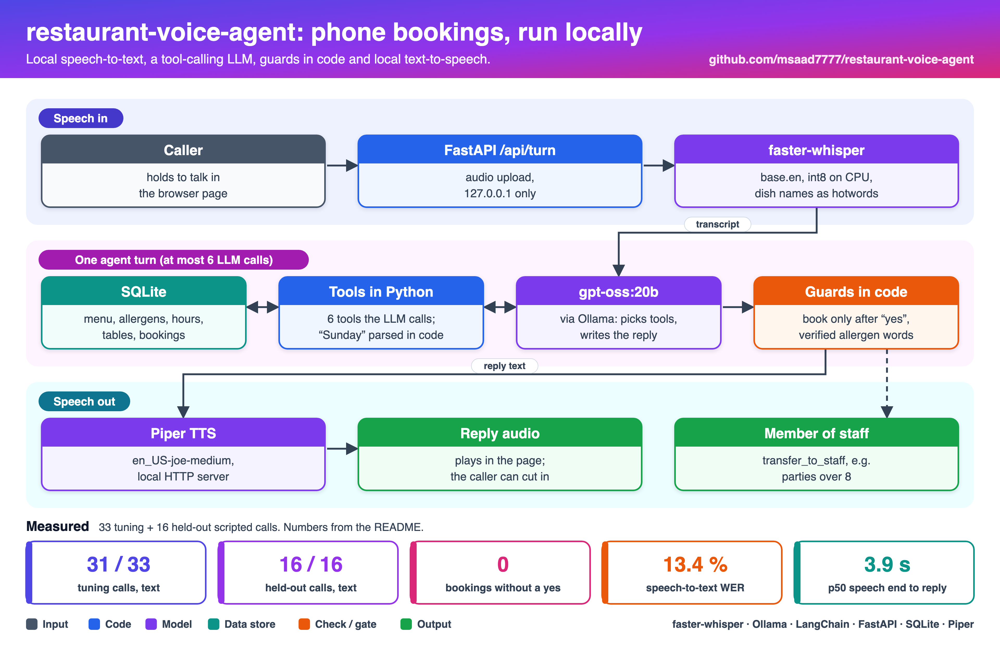
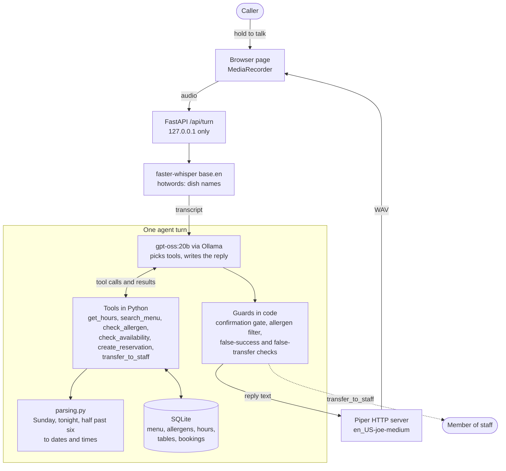

# Restaurant voice agent

A phone host for **Juniper and Rye**, a fictional restaurant. It answers questions about the menu, hours and allergens, takes bookings, and hands the call to a person when it should. Everything runs on one laptop with free, local models:

| Step | Tool |
|---|---|
| Speech to text | [faster-whisper](https://github.com/SYSTRAN/faster-whisper) `base.en` (int8, CPU) |
| Understanding and tool choice | `gpt-oss:20b` through [Ollama](https://ollama.com), LangChain tool calling |
| Tools and data | Python and SQLite |
| Text to speech | [Piper](https://github.com/OHF-Voice/piper1-gpl), run as a separate HTTP server |
| Web front end | FastAPI and a push-to-talk page |

There are no API keys and no cloud calls. The restaurant, menu, allergen data and bookings are all made up.

The project tries to answer one question: **does every part of a voice agent need an LLM?** The answer from the build and the eval is no. The LLM is good at understanding what the caller wants and choosing a tool. Date arithmetic, allergen wording and "may I book this now?" are better done in code. See [What the LLM does and doesn't do](#what-the-llm-does-and-doesnt-do).

## Architecture



<details>
<summary>Same diagram as text (Mermaid)</summary>



</details>

One turn is: audio in, transcript, at most six LLM calls with tools in between, guards on the final text, then speech out. The caller can interrupt: pressing the talk button stops playback and aborts the request in flight. On the server, a newer turn marks the older one as superseded, so its reply is dropped from the conversation history unless it already booked a table or transferred the call.

## Tools

The model sees these six tools (definitions in [`tools.py`](src/voice_agent/tools.py)). Days and times are passed as the caller said them, and code works out the date.

| Tool | What it does | Notes |
|---|---|---|
| `get_hours(date?)` | Opening hours for one day or the week | Closed Mondays; last booking 90 minutes before close |
| `search_menu(query?, category?, dietary?)` | Dish names, prices, descriptions, vegetarian or vegan tags | Has **no** allergen data on purpose |
| `check_allergen(dish, allergen)` | The only source of allergen answers | Returns a status and a `say` sentence built from the verified allergen fields |
| `check_availability(date, time, party_size)` | Is a table free? | Suggests up to three nearby times when full; refuses closed days, times outside booking hours, and parties over 8 |
| `create_reservation(name, party_size, date, time)` | Books a table and returns a code like `JR-1009` | Re-checks availability; refused unless the caller has just said yes |
| `transfer_to_staff(reason)` | Hands the call to a person and ends the agent's part | `reason` must map to one of six allowed reasons |

`check_allergen` has five outcomes, and only the first three give an answer:

| Status | Example `say` |
|---|---|
| `contains` | "Yes, the Pesto Linguine contains tree nuts (pine nuts)." |
| `may_contain` | "The Hand-Cut Fries has no shellfish as an ingredient, but it may contain shellfish from cross-contact, so we can't guarantee it's free of it." |
| `not_listed` | "According to our verified allergen list, the Wild Mushroom Risotto does not contain tree nuts or peanuts." |
| `unverified` | "I can't confirm allergens for the Chef's Seasonal Special, because its allergen information hasn't been verified. I can connect you with a member of staff who can check with the kitchen." |
| `unknown_dish` | "I couldn't find lobster bisque on our menu, so I can't give allergen information for it." |

Two dishes (the weekly special and the sorbet of the day) are deliberately marked unverified, so the eval can check that the agent never calls them safe.

## Guards: what code enforces after the model

These run on every turn ([`agent.py`](src/voice_agent/agent.py)). Each one exists because of something seen during the build or the eval.

| Guard | Rule | Why |
|---|---|---|
| Confirmation gate | `create_reservation` is refused unless the caller's latest words are a yes ("yes", "go ahead", "book it"…) with no "no", "wait" or "actually" | A booking must not happen before the caller agrees to the read-back |
| Allergen filter | In an allergen turn, any sentence that mentions an allergen and isn't one of the tool's `say` sentences is removed, and the verified sentence is put in its place | The model can paraphrase "may contain" into "is fine" |
| Allergen nudge | If the caller asks about allergens and the model didn't call `check_allergen`, it gets one more try with a reminder | gpt-oss asked "which dish?" when the caller had named it |
| Allergen must be heard | `check_allergen` is refused if the caller never said that allergen (or a synonym) in the last three turns | In the audio eval, Whisper turned "have fish in it" into "efficient it", and the model guessed "nuts" and gave a verified answer to a question nobody asked |
| False success | "You're booked" or a `JR-` code without a successful `create_reservation` is replaced with an honest failure | Needed when the booking tool fails |
| False transfer | "I'll transfer you" without a successful `transfer_to_staff` gets one nudge, then the claim is removed and a transfer is offered | gpt-oss often said it was transferring and never called the tool |

## A sample call

From the text eval (scenario B07). The tool calls are real, and the replies come straight from the run.

> **Caller:** Can I reserve a table for four people at 7:30 tonight? Also, does the pesto contain nuts? I'm allergic to nuts.
> `check_allergen(dish="pesto", allergen="nuts")` → contains
> `check_availability(date="tonight", time="7:30 pm", party_size=4)` → full; alternatives 5:30 pm, 8:30 pm, 9 pm
> **Agent:** I'm sorry, but the restaurant is fully booked at 7:30 pm tonight for a party of four. We can offer you 5:30 pm, 8:30 pm, or 9 pm instead. Yes, the Pesto Linguine contains tree nuts (pine nuts).
>
> **Caller:** Hmm, okay, 8:30 then. The name is Laila.
> `check_availability(date="tonight", time="8:30 pm", party_size=4)` → available
> **Agent:** Great, the table is available for you at 8:30 pm tonight for four people. Shall I book that for Laila?
>
> **Caller:** Yes, book it.
> `create_reservation(name="Laila", party_size=4, date="tonight", time="8:30 pm")` → created, JR-1009
> **Agent:** Your table is booked for Laila, four people, tonight at 8:30 pm. Your confirmation code is JR-1009. Enjoy your meal!

And when the booking tool is down (scenario F02, fault injected):

> **Caller:** Yes, please book it.
> `create_reservation(...)` → `{"error": "tool_unavailable"}`
> **Agent:** I'm sorry, I can't book that right now. I can transfer you to a staff member to complete the reservation. Would you like me to do that?

## How it handles failure

| Situation | What happens | Checked by |
|---|---|---|
| Caller cut off mid-sentence ("Hi, can I book a table") | Asks for the missing details and doesn't act on half a request | I01, I02, HI1 (audio is truncated at 40–60 %) |
| Speech-to-text gets a time wrong (heard 9:30 for 7:30) | The read-back before booking lets the caller correct it; only the corrected time is booked | B08 |
| Requested time is full | Offers the tool's alternatives | B04, B07, HB4 |
| Closed day or outside booking hours | Says so, with the last booking time | B05, B06, HB5 |
| A tool fails | Says it can't check right now and offers a transfer; never claims success | F01–F04, HF1 (faults injected per tool) |
| Unverified allergen data | Repeats the "hasn't been verified" sentence, never "it's safe" | A03, HA4, X04 |
| Party over 8, complaint, "get me a person" | Transfers to staff | X01–X03, HX1, HX2 |
| Caller interrupts the agent | Playback stops, the old request is aborted, the old turn isn't committed | unit test `test_superseded_turn_is_not_committed` |

## Evaluation

[`eval/run_eval.py`](eval/run_eval.py) plays scripted calls against the agent on a fresh database, with "today" fixed to Friday 2026-11-13. Bookings already in the database make tonight around 7:30 full for parties of three or more.

- **Tuning set:** 33 calls ([`eval/scenarios.jsonl`](eval/scenarios.jsonl)) covering bookings, full slots, closed days, allergens, menu, hours, handoffs, cut-off speech, a misheard time and injected tool failures. The prompt, tools, guards and rule baseline were all changed while looking at these, so they flatter every agent.
- **Held-out set:** 16 calls ([`eval/heldout.jsonl`](eval/heldout.jsonl)) with different wording ("grab a spot for 2", "half past six", "lock it in"). They were written before any LLM run on them and nothing was tuned on them.
- **Audio mode:** each call is spoken by a different [LibriTTS-R](https://www.openslr.org/141/) voice through Piper, transcribed by Whisper, answered by the agent, and the reply is synthesised by Piper. Synthetic voices are cleaner than real phone audio, so these numbers are an upper bound for real calls.

A call **passes** only if the database ends in exactly the expected state (the right booking, or none), the handoff is right, every required phrase was said (for example the verified allergen sentence or a `JR-` code), no forbidden phrase was said (for example "gluten free" for an unverified dish), and a cut-off turn caused no booking or transfer.

### Results

All runs on an Apple M4 laptop with 24 GB of RAM. Latency is per turn: the agent's time, including all LLM and tool calls.

| Agent | Tuning (33) | Held-out (16) | Agent time per turn p50 / p95 |
|---|---|---|---|
| gpt-oss:20b + guards | **31 / 33** (0.939) | **16 / 16** | 3.3 s / 5.4 s |
| qwen3:8b + guards | 30 / 33 (0.909) | 16 / 16 | 4.1 s / 8.2 s |
| llama3.2:3b + guards | 25 / 33 (0.758) | 15 / 16 (0.938) | 2.9 s / 3.6 s |
| gpt-oss:20b, guards off | 29 / 33 (0.879) | not run | 3.2 s / 5.0 s |
| Rules only, no LLM | 33 / 33 | 10 / 16 (0.625) | under 1 ms |

The latency column is for the tuning set.

Across every run: **0 bookings made without a yes**, and **0 forbidden phrases**, except one llama3.2 run. In A07, llama3.2 was told "I'm allergic to peanuts" with no dish named, so it checked a dish of its own choosing and read out the (true) result.

**Handoffs (tuning set, 4 calls should transfer, 29 shouldn't):** gpt-oss with guards transferred 3 of 4 with no wrong transfers. With the guards off it transferred only 1 of 4. In the other two cases it told the caller "I'll transfer you" and never did. The miss with guards on is X04: a parent asks for a guarantee that the unverified sorbet is nut-free. The agent refuses the claim correctly but offers a transfer instead of making one. All three models missed this one.

### With speech in the loop (gpt-oss:20b + guards)

| Speech to text | Calls passed | Passed if names are ignored | Word error rate | Whisper p50 | End of speech to reply audio, p50 / p95 |
|---|---|---|---|---|---|
| `base.en`, tuning (33) | 23 / 33 (0.697) | 27 / 33 (0.818) | 13.4 % | 300 ms | 3.9 s / 6.6 s |
| `small.en`, tuning (33) | 26 / 33 (0.788) | 30 / 33 (0.909) | 10.2 % | 987 ms | 4.7 s / 7.7 s |
| `base.en`, held-out (16) | 10 / 16 (0.625) | 13 / 16 (0.812) | 17.6 % | 301 ms | 3.7 s / 6.0 s |
| `base.en`, rules agent (33) | 23 / 33 (0.697) | 24 / 33 (0.727) | 13.4 % | 276 ms | 0.36 s / 0.57 s |

"End of speech to reply audio" is Whisper time, plus agent time, plus Piper time (p50 about 150 ms). It doesn't include audio upload or playback. Replies aren't streamed, so this is the full wait before the agent starts speaking.

### What the numbers say

- **Speech is the weak link, not the LLM.** The same agent goes from 31/33 in text to 23/33 with `base.en`. Most of the drop is names: Amara became "Mara", Dmitri "Tamitri", Fitzgerald "Gerald Fitz", Adeyemi "a daimi". The agent read each one back and the scripted caller said yes, because a script can't hear its own name misspelt. A real caller might catch it. The next step is spelling names back letter by letter, or asking for a phone number instead. Number words cause the rest: "for 2" became "for to", "four people" became "for people", "8:30" became "A30".
- **`small.en` is worth it.** Word errors fall from 13.4 % to 10.2 % and pass rate rises from 23 to 26, for about 0.7 s more per turn.
- **Rules are fast but brittle.** They pass all 33 calls they were written against and only 10 of 16 new ones, failing on wording like "grab a spot for 2" and "half eight". The LLM agents pass all 16 held-out calls in text.
- **The smaller model is faster, not better.** llama3.2:3b saves about 0.4 s per turn but fails 8 of the 33 tuning calls. qwen3:8b is about as accurate as gpt-oss:20b but slower at p95 on this machine.
- **The guards mostly earn their place on handoffs.** On this set gpt-oss rarely made unsafe allergen claims even without guards, so their measured value is in transfers (1/4 to 3/4) and in the audio run, where the "allergen must be heard" guard stopped a wrong answer.

The full per-call results, transcripts, tool calls and timings are in [`eval/results/`](eval/results/). For example, `text_gpt-oss-20b.json` has every turn of every call.

## What the LLM does and doesn't do

| Job | Who does it | Why |
|---|---|---|
| Understand "grab a spot for 2 this coming Wednesday around eight thirty" | LLM | Rules handled 10 of 16 new phrasings; the LLM handled 16 of 16 |
| Choose the tool and fill its arguments | LLM | Same reason |
| Turn "Sunday" or "tonight" into a date | **Code** | gpt-oss turned "Sunday" into 2026-11-12, a Thursday that had already passed, and told the caller it closed at 10 pm. The tools now take the day as spoken and resolve it in [`parsing.py`](src/voice_agent/parsing.py) |
| Allergen wording | **Code** | Allergen answers are a safety issue. The sentence comes from the verified fields, and the guard removes anything else |
| Deciding it may book | **Code** | A booking needs an explicit yes |
| Deciding a transfer happened | **Code** | Only a successful tool call counts |
| Writing the rest of the reply | LLM | Short, spoken, in context |

## What failed during the build

- **The model did date arithmetic.** The first end-to-end voice test answered "We're open until 10 pm on Sundays", which is wrong (Sunday closes at 9 pm). The tool call showed `get_hours(date="2026-11-12")`, a Thursday. Since then, dates are resolved in code.
- **A bare "7" wasn't a time.** gpt-oss passed `time="7"`, the parser wanted "at 7" or "7 pm", and several bookings failed with "I couldn't understand the time". A bare hour now means the evening.
- **Hidden Unicode.** gpt-oss writes confirmation codes with a non-breaking hyphen (`JR‑1009`) and apostrophes as `’`. The second one stopped the false-transfer regex from matching "I’ll transfer you". Replies are now normalised before any guard runs.
- **Over-eager transfers, then none.** gpt-oss transferred a caller who had just given their name. Restricting `reason` to an enum stopped that, but then real transfers failed because the model wrote "caller asking for a person" instead of the exact value. Free-text reasons are now mapped onto the allowed list by keyword, and anything else is refused.
- **`dietary: "none"`.** The model sent it as a filter and the menu search returned nothing, so "how much is the burger?" got "we don't have a burger". Unknown filter values are now ignored.
- **The scorer was wrong twice.** It counted a failed booking attempt as an unexpected booking, and it treated a misheard name the same as a wrong table. Both were fixed and the saved runs re-scored; names are now reported separately.

## Limitations

- **Small, hand-written test sets.** 33 + 16 calls, written by the same person who built the agent. The held-out set guards against tuning, but it isn't a benchmark.
- **Synthetic callers.** Piper voices are clean, steady and in American English. Real phone audio at 8 kHz, with accents, background noise and people talking over each other, will be worse.
- **Turn-based, not streaming.** The caller holds a button, and the reply starts only when it's fully written and synthesised. A production agent would stream speech in and out and detect the end of speech automatically.
- **One shared database lock.** Turns are serialised. That's fine for a demo, not for many calls at once.
- **No authentication.** The server binds to `127.0.0.1`; don't expose it.
- **Not a real phone line.** No SIP or telephony provider is connected.

## Data, models and licences

| Item | Source | Licence |
|---|---|---|
| Restaurant, menu, allergens, hours, bookings | Written for this project ([`data.py`](src/voice_agent/data.py)); fictional | MIT, with this repo |
| Eval calls | Written for this project ([`eval/`](eval/)) | MIT |
| gpt-oss-20b | OpenAI, via Ollama | Apache-2.0 |
| qwen3:8b | Alibaba Qwen, via Ollama (comparison only) | Apache-2.0 |
| llama3.2:3b | Meta, via Ollama (comparison only) | Llama 3.2 Community License |
| Whisper `base.en`, `small.en` | OpenAI weights, CTranslate2 conversion used by faster-whisper | MIT |
| Piper | [OHF-Voice/piper1-gpl](https://github.com/OHF-Voice/piper1-gpl) 1.8.0 | GPL-3.0-or-later. **Not a dependency of this repo**: it runs as a separate process and is called over HTTP |
| Voice `en_US-joe-medium` (the agent) | [rhasspy/piper-voices](https://huggingface.co/rhasspy/piper-voices), dataset from OHF-Voice/voice-datasets | Dataset CC0 per its model card; fine-tuned from a CC0 base voice. Downloaded separately, not committed |
| Voice `en_US-libritts_r-medium` (eval callers only) | rhasspy/piper-voices, trained on LibriTTS-R | Dataset CC BY 4.0, **but the model card says it was fine-tuned from `en_US-lessac-medium`**, whose dataset is not licensed for commercial use. It is used only to generate test audio on my machine; no audio from it is committed or shipped |

The agent's own voice was chosen for its CC0 data. For a commercial product, the eval caller voice should be swapped for one with no non-commercial ancestry. No voice files or audio clips are committed; `eval/audio/` is regenerated by the eval.

## How to run

You need Python 3.12, [uv](https://docs.astral.sh/uv/), [Ollama](https://ollama.com) and ffmpeg.

```bash
uv sync
ollama pull gpt-oss:20b          # about 13 GB
uv run pytest -q                 # 18 unit tests, no models needed
```

Download the two Piper voices into `voices/` (each needs its `.onnx` and `.onnx.json` file) from [rhasspy/piper-voices](https://huggingface.co/rhasspy/piper-voices/tree/main/en/en_US), then start Piper in one terminal:

```bash
./scripts/piper.sh               # http://127.0.0.1:5100
```

And the app in another:

```bash
uv run uvicorn voice_agent.server:app --host 127.0.0.1 --port 8830
```

Open http://127.0.0.1:8830, press **Start call**, then hold **Hold to talk**, or type in the text box. Set `AGENT_TODAY=2026-11-13` to use the same date as the eval, `AGENT_MODEL` to try another Ollama model, and `STT_MODEL=small.en` for the more accurate Whisper model.

Run the eval:

```bash
uv run python eval/run_eval.py text --agent rules                    # no models, under a second
uv run python eval/run_eval.py text --agent gpt-oss:20b --set heldout
uv run python eval/run_eval.py audio --agent gpt-oss:20b --stt base.en   # needs Piper running
./scripts/run_all_evals.sh                                         # the full matrix, about 40 minutes
```

CI runs the unit tests and the rule-baseline eval on every push. They need no models.

## Layout

```
src/voice_agent/
  data.py        fictional restaurant data, loaded into SQLite
  tools.py       the six tools and their JSON schemas
  parsing.py     spoken dates, times and party sizes
  agent.py       LLM agent loop and guards
  baseline.py    rules-only agent for comparison
  speech.py      faster-whisper and the Piper HTTP client
  server.py      FastAPI app
  static/        push-to-talk page
eval/            scenarios, held-out calls, runner, results
scripts/         piper.sh, run_all_evals.sh
tests/           unit tests (scripted LLM, no models)
```

## Licence

MIT. See [LICENSE](LICENSE).
